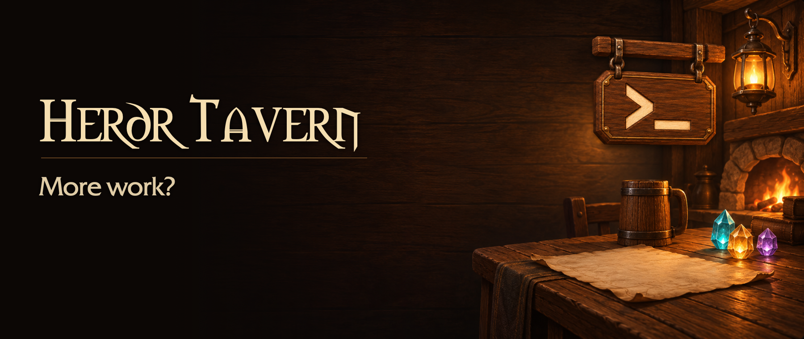

# 

English · [Русский](README.ru.md)

A native macOS client for **[herdr](https://github.com/herdrdev/herdr)** with a tavern-themed interface. Run Oh My Pi, Codex, and other terminal programs side by side in split panes. Herdr manages the sessions and processes.

> [!IMPORTANT]
> **Independent, unofficial project.** Herdr Tavern is not affiliated with or endorsed by the herdr project or its maintainers. The word “herdr” in the name identifies the tool it works with, not an official connection. **[Original herdr repository →](https://github.com/herdrdev/herdr)**

https://github.com/user-attachments/assets/850a079e-4e12-4842-a6ab-5b34cc973784

**30 seconds, with sound.** English interface, Russian captions.

## Features

- Workspaces and tabs for different projects.
- Split, merge, and resize terminal panes.
- Drag individual or grouped tabs without restarting their processes.
- Agent cards with status, animated talismans, input requests, and unread reply indicators.
- Agent integration management, configurable sounds, and macOS notifications.
- English and Russian UI, switchable without restarting. Support for the system Reduce Motion setting.

Closing the window leaves the herdr session running. Closing a pane or tab stops its processes and requires confirmation. Agent programs and model access are configured separately.

Terminal history stays in herdr; Tavern keeps the current screen grid. Temporary receive objects are released after each event, and images are decoded into owned rasters on the reader before reaching the UI. Local terminal updates redraw the affected glyph, cursor, selection, and composition regions; full frames and geometry changes still redraw the whole surface. Bitmap glyphs with unknown ink bounds conservatively request a full redraw.

Link hover resolves files in the background with a short-lived cache. Clicking a file link still checks its current existence synchronously.

## Build and run

To build locally, you need **macOS 14+**, **Xcode Command Line Tools**, and **Rust stable with Cargo**. First [set up the local signing certificate](docs/SETUP.md#local-signing); keep it for future builds.

From the repository root:

```sh
./build.sh
open "build/Herdr Tavern.app"
```

If herdr is missing, Tavern offers to install the official pinned **0.9.4** release after your confirmation. You can also [install herdr yourself](https://github.com/herdrdev/herdr#readme). It is not bundled with Tavern, and an existing installation is not overwritten or updated.

Open **Settings** with `⌘,` to choose a language, connect agent integrations, and adjust sounds. Start your installed agent in a terminal pane; changing an integration requires restarting that agent.

[Build, signing, sessions, and settings →](docs/SETUP.md)

## Limitations

- Builds target your machine's architecture, not a universal binary. Compatibility with arbitrary newer herdr versions is not guaranteed.
- Tavern is a graphical client, not a replacement for every herdr TUI feature or built-in shortcut.
- Text and image paste and Finder drops work with the terminal program inside the pane. A Finder drop inserts paths; it does not upload files or send Enter.

For source layout, tests, and protocol provenance, see [Development](docs/SETUP.md#development).

## Licenses

Original code, shaders, tools, and documentation are licensed under [Apache-2.0](LICENSE). Third-party resources have separate terms: see [NOTICE](NOTICE) and [licenses/](licenses/). Russian reference translations are available in [LICENSE.ru](LICENSE.ru) and [NOTICE.ru](NOTICE.ru); the English originals remain authoritative.

The current WoW sounds and interface fonts are retained with attribution despite unconfirmed redistribution permissions. Disputed resources will be removed or replaced upon a rights holder's request. This grants recipients no rights to those files; the complete resource bundle is **not** represented as freely licensed. See NOTICE for the contact procedure.
