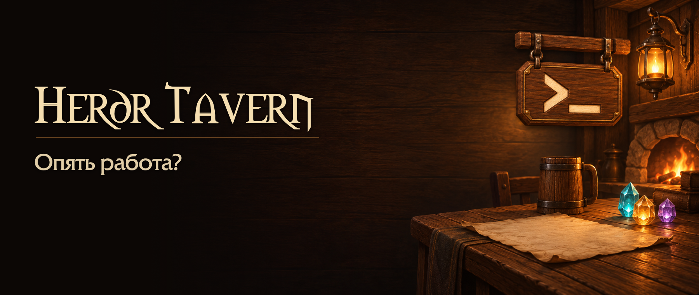

# 

[English](README.md) · Русский

Нативный клиент **[herdr](https://github.com/herdrdev/herdr)** для macOS с оформлением таверны. Oh My Pi, Codex и другие терминальные программы можно открыть рядом в разделённых панелях. Сессиями и процессами управляет herdr.

> [!IMPORTANT]
> **Независимый, неофициальный проект.** Herdr Tavern никак не аффилирован с проектом herdr или его разработчиками и не одобрен ими. Слово «herdr» в названии указывает на инструмент, с которым работает Tavern, а не на официальную связь. **[Оригинальный репозиторий herdr →](https://github.com/herdrdev/herdr)**

https://github.com/user-attachments/assets/850a079e-4e12-4842-a6ab-5b34cc973784

**30 секунд, со звуком.** Английский интерфейс, русские титры.

## Возможности

- Рабочие пространства и вкладки для разных проектов.
- Разделение, объединение и изменение размеров терминальных панелей.
- Перетаскивание одиночных и сгруппированных вкладок без перезапуска процессов.
- Карточки агентов со статусами, анимированными талисманами, запросами ввода и отметками непрочитанных ответов.
- Управление интеграциями агентов, настройка звуков и уведомлений macOS.
- Настройка размера и насыщенности терминального шрифта с предпросмотром и сохранением выбора.
- Русский и английский интерфейс, переключение языка без перезапуска. Поддержка системного режима уменьшения движения.

Закрытие окна не останавливает сессию herdr. Закрытие панели или вкладки завершает её процессы и требует подтверждения. Сами агенты и доступ к моделям настраиваются отдельно.

Терминальную историю хранит herdr; Tavern держит текущую экранную сетку. Временные объекты приёма освобождаются после каждого события, а изображения декодируются в принадлежащие клиенту растры на потоке чтения до передачи в интерфейс. Локальные изменения перерисовывают затронутые области глифов, курсора, выделения и композиции; полные кадры и смена геометрии по-прежнему обновляют всю поверхность. Для растровых глифов с неизвестными границами рисунка консервативно используется полная перерисовка.

Наведение на ссылки проверяет файлы в фоне с краткоживущим кэшем. При нажатии существование файла по-прежнему перепроверяется синхронно.

## Сборка и запуск

Для сборки нужны **macOS 14+**, **Xcode Command Line Tools** и **Rust stable с Cargo**. Перед первой сборкой нужно [подготовить локальный сертификат подписи](docs/SETUP.ru.md#локальная-подпись); тот же сертификат используется при обновлениях.

Из корня репозитория:

```sh
./build.sh
open "build/Herdr Tavern.app"
```

Если herdr не найден, Tavern предложит установить официальный закреплённый релиз **0.9.4** и начнёт загрузку только после подтверждения. Можно [установить herdr вручную](https://github.com/herdrdev/herdr#readme). Он не входит в комплект Tavern; существующая установка не перезаписывается и не обновляется.

В **Настройках** (`⌘,`) доступны язык, интеграции агентов и звуки. Агент запускается своей обычной командой в терминальной панели. После изменения интеграции его нужно перезапустить.

[Сборка, подпись, сессии и настройки →](docs/SETUP.ru.md)

## Ограничения

- Сборка рассчитана на архитектуру текущей машины, не является универсальной. Совместимость с произвольной новой версией herdr не гарантируется.
- Tavern — графический клиент, а не полный перенос всех функций и встроенных сочетаний терминального интерфейса herdr.
- Вставка текста и изображений и перетаскивание из Finder зависят от программы внутри панели. Перетаскивание вставляет пути, но не загружает файлы и не отправляет Enter.

Исходники, проверки и происхождение протокола описаны в разделе [Разработка](docs/SETUP.ru.md#разработка).

## Лицензии

Собственный код, шейдеры, инструменты и документация — [Apache-2.0](LICENSE). У сторонних ресурсов свои условия: [NOTICE.ru](NOTICE.ru) и [licenses/](licenses/). [LICENSE.ru](LICENSE.ru) и NOTICE.ru — справочные переводы; английские оригиналы [LICENSE](LICENSE) и [NOTICE](NOTICE) имеют приоритет.

Текущие WoW-звуки и интерфейсные шрифты сохранены с атрибуцией при неподтверждённых разрешениях на распространение. По обращению правообладателя спорные ресурсы будут удалены или заменены. Это не предоставляет получателям прав на эти файлы: весь комплект ресурсов **не заявляется свободно лицензированным**. Порядок обращения указан в NOTICE.ru.
